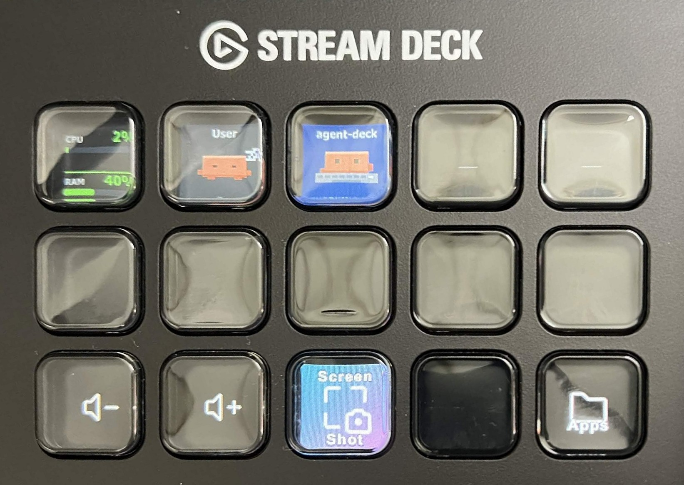

# Agent Deck

[English](README.md) | **한국어**

Stream Deck 키 하나에 Claude Code(또는 Codex) 세션 하나를 보여주는 Windows용 플러그인입니다. 픽셀 마스코트가 세션이 하는 일에 맞춰 움직이고, 키를 누르면 그 세션의 터미널 창으로, Windows Terminal이면 해당 탭까지 바로 이동합니다.

<p align="center">
  
</p>

[CodeIsland](https://github.com/wxtsky/CodeIsland)에서 영감을 받았습니다.

## 기능

| 키 | 표시 | 누르면 |
| --- | --- | --- |
| **Agent Session** | 세션 하나: 프로젝트 이름, 마스코트, 상태 | 그 세션의 터미널 창이나 탭으로 이동 |
| **Next Waiting** | 나를 기다리는 세션 수 | 가장 급한 세션으로 이동 |
| **System Monitor** | CPU, RAM 사용량 | 작업 관리자 열기 |
| **Claude App** | Claude 데스크톱 앱 실행 여부 | 앱을 앞으로 가져오기, 꺼져 있으면 실행 |
| **Claude Here** | 폴더 아이콘 | 포커스된 탐색기 폴더에서 `claude` 시작 (새 Windows Terminal 창 → WSL) |

Agent Session 키의 상태 표시:

| 색 | 마스코트 | 글자 | 의미 |
| --- | --- | --- | --- |
| 파랑 | 타이핑 | `WORKING 1:23` | 작업 중 |
| 주황, 깜빡임 | 팔 흔들기, `!` 또는 `?` 말풍선 | `APPROVE?` / `QUESTION` / `NEEDS YOU` | 나를 기다림 |
| 초록 | 두 팔 들기, 체크 표시 | `DONE` | 턴 종료 |
| 어두운 회색 | 자는 중 | `Zzz` | 이미 확인했거나 쉬는 중 |
| 빨강 | X 눈 | `ERROR` | API 오류로 중단 |

## 설치

Windows 10/11, Stream Deck 앱 7.0 이상, Claude Code Windows 버전 2.1.119 이상이 필요하고, 빌드에는 Node.js 20 이상과 git이 필요합니다. Claude Here 키는 WSL과 Windows Terminal이, Claude App 키는 Claude 데스크톱 앱이 추가로 필요합니다.

```powershell
git clone https://github.com/hyeonbeomy/agent-deck.git
cd agent-deck
npm install
npm run build
npm run link
```

Stream Deck 앱을 완전히 종료했다가 다시 실행한 뒤, 액션 목록의 **Agent Deck** 카테고리에서 키를 끌어다 놓습니다.

`npm run link`는 Windows 개발자 모드가 필요합니다. 실패하거나 Node.js가 없는 PC에 설치할 때는 `npm run pack`으로 만든 `.streamDeckPlugin` 파일을 더블클릭하세요.

## 사용법

- **세션은 알아서 나타납니다.** 아무 터미널(cmd, PowerShell, Windows Terminal, Windows용 `claude`를 호출하는 WSL 셸)에서 `claude`를 실행하면, 열린 순서대로 왼쪽 위의 빈 Agent Session 키부터 채워집니다. 키를 누르면 그 터미널이 앞으로 옵니다.
- **키를 한 프로젝트에 고정**하려면 키 속성 창의 **고정할 프로젝트**에 폴더 이름을 적습니다.
- **Next Waiting**은 승인·질문 대기, 오류, 확인하지 않은 완료 순으로 돌아봅니다.
- **Claude Here**: 탐색기 창을 클릭한 뒤 키를 누릅니다. 그 창의 폴더(하위 폴더 하나를 선택했으면 그 폴더), 마우스 아래 탐색기 창, 바탕화면, 키 설정의 기본 폴더, 홈 폴더 순으로 고릅니다. WSL에 마운트되지 않은 위치(NAS 공유, 네트워크 드라이브, Google Drive)는 먼저 `/mnt/` 아래에 마운트합니다. 새 Windows Terminal 창이 열려 그 폴더에서 `claude`가 실행되고, 1~2초 뒤 세션이 키에 나타납니다.
- **선택 사항인 hook**: `node hooks\windows\install.mjs`를 실행하면 승인과 질문의 구분, 실행 중인 툴 이름, 오류 상태가 추가되고, 제목이 같은 세션들도 구분합니다. 백업을 만든 뒤 `~/.claude/settings.json`을 수정하며 `--uninstall`로 되돌립니다. WSL 안에 설치한 Linux용 claude는 `bash hooks/wsl/install.sh`를 설치해야 키에 보입니다.

Codex와 문제 해결을 포함한 자세한 내용은 [docs/reference.ko.md](docs/reference.ko.md)에 있습니다.
