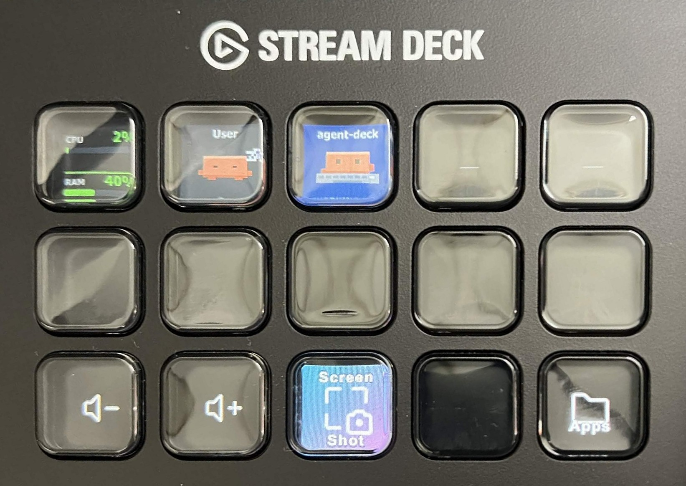
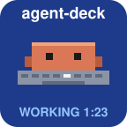
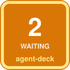
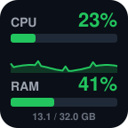
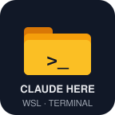
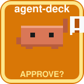
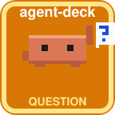
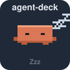
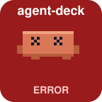

# Agent Deck

**English** | [한국어](README.ko.md)

A Stream Deck plugin for Windows that shows one Claude Code (or Codex) session per key. A pixel mascot acts out what the session is doing, and pressing the key jumps to the session's terminal, down to the right Windows Terminal tab.

<p align="center">
  
</p>

Inspired by [CodeIsland](https://github.com/wxtsky/CodeIsland).

## Features

| | Key | Shows | Press |
| --- | --- | --- | --- |
|  | **Agent Session** | One session: project name, mascot, state | Jump to its terminal window or tab |
|  | **Next Waiting** | How many sessions are waiting for you | Jump to the most urgent one |
|  | **System Monitor** | CPU and RAM use | Open Task Manager |
|  | **Claude App** | Whether the Claude desktop app is running | Bring it to the front, starting it if needed |
|  | **Claude Here** | A folder with a prompt | Start `claude` in the focused Explorer folder (new Windows Terminal window → WSL) |

States on an Agent Session key:

| Key | Text | Meaning |
| --- | --- | --- |
|  | `WORKING 1:23` | Working |
|  | `APPROVE?` / `NEEDS YOU` | Waiting for your approval or input (pulses) |
|  | `QUESTION` | Claude is asking you a question (pulses) |
|  | `DONE` | Turn finished |
|  | `Zzz` | Already seen, or idle |
|  | `ERROR` | Stopped on an API error |

States of the other keys:

| Key | Meaning |
| --- | --- |
|  | Next Waiting: nothing is waiting |
|  | Next Waiting: two sessions are waiting, the most urgent one is named |
|  | Claude App: the desktop app is running |
|  | Claude App: the desktop app is not running |

## Install

You need Windows 10/11, the Stream Deck app 7.0 or later, Claude Code for Windows 2.1.119 or later, and Node.js 20 or later with git for the build. The Claude Here key also needs WSL and Windows Terminal, and the Claude App key needs the Claude desktop app.

```powershell
git clone https://github.com/hyeonbeomy/agent-deck.git
cd agent-deck
npm install
npm run build
npm run link
```

Quit the Stream Deck app completely and start it again, then drag the keys from the **Agent Deck** category onto the deck.

`npm run link` needs Windows Developer Mode. If it fails, or for a PC without Node.js, run `npm run pack` and double-click the `.streamDeckPlugin` file it creates.

## Usage

- **Sessions appear by themselves.** Start `claude` in any terminal (cmd, PowerShell, Windows Terminal, or a WSL shell that calls the Windows `claude`). It takes the next free Agent Session key, filling from the top left in the order sessions were started. Press the key to bring that terminal to the front.
- **Pin a key to a project** by typing the folder name into the key's 고정할 프로젝트 (pinned project) field.
- **Next Waiting** goes through approvals and questions first, then errors, then finished turns you have not looked at.
- **Claude Here**: click an Explorer window, then press the key. It uses that window's folder (or its one selected sub-folder), then the Explorer window under the cursor, the desktop, the default folder from the key's settings, and last your home folder. Locations WSL has not mounted (NAS shares, network drives, Google Drive) are mounted under `/mnt/` first. A new Windows Terminal window opens with `claude` running in that folder, and the session gets its own key a second or two later.
- **Optional hook**: `node hooks\windows\install.mjs` adds the approval / question distinction, tool names and the error state, and tells sessions with identical titles apart. It edits `~/.claude/settings.json` after writing a backup; `--uninstall` removes it. A Linux claude installed inside WSL needs `bash hooks/wsl/install.sh` to be seen at all.

More detail, including Codex and troubleshooting, is in [docs/reference.md](docs/reference.md).
